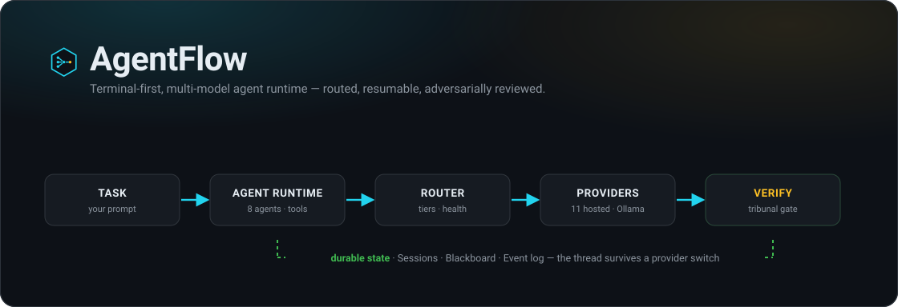
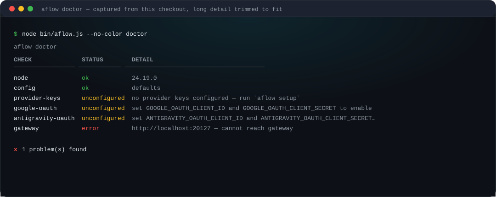
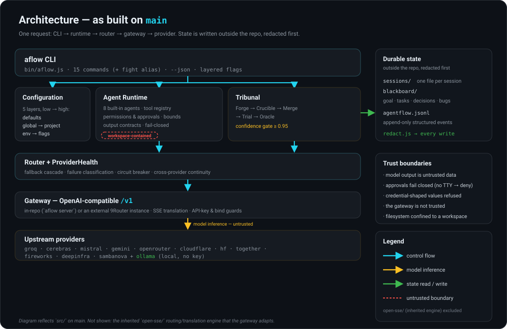
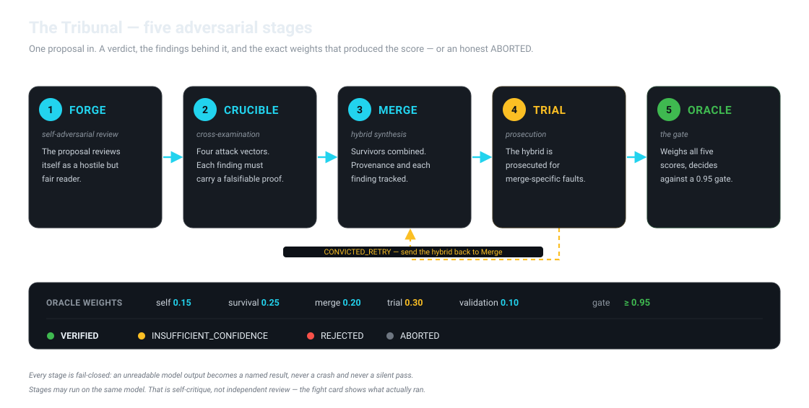

<div align="center">



**A terminal-first CLI that routes a coding task across twelve model providers, keeps the thread alive when one of them dies, and puts the answer on trial in a five-stage adversarial review.**

[](LICENSE)
[](package.json)
[](THIRD_PARTY_NOTICES.md)
[](test)

[Quick start](#quick-start) · [Why AgentFlow](#why-agentflow) · [Architecture](#architecture) · [The Tribunal](#the-tribunal) · [Providers](#providers-and-local-models) · [Security](#trust-safety-and-verification)

</div>

---

**AgentFlow is an open-source coding agent for the terminal.** It fronts an
OpenAI-compatible model gateway with a routing engine that measures which models
actually answer, a durable session and project-state layer that survives a
provider switch, and a self-adversarial tribunal that reviews a proposal before
you act on it. It ships with **zero runtime dependencies** — the Node standard
library and nothing else — and runs straight from source on Node ≥ 20.

## The problem

A gateway hands you a catalogue of models. What it does not tell you is which of
them will answer *right now*.

Free-tier and aggregator endpoints are the worst offenders: the catalogue is
large, the credentials shared or expired, and a dead model often fails as a `200`
with an empty body rather than an error you can catch. Your tool reports success.

**Advertised** and **working** are different facts, and most tooling collapses
them into one. AgentFlow measures the gap — in `aflow doctor` (probes specific
models), in `aflow route` (walks a fallback order and records why each step
failed), and in the router itself, which orders candidates by observed health
rather than by the order a provider happened to list them. The same discipline
runs through the review layer: a proposal is a claim, and the tribunal exists to
test it rather than agree with it.

## See it working

No build step, no `npm install`. Clone it and run a diagnostic:

```sh
git clone https://github.com/anand-cpp/AgentFlow.git
cd AgentFlow
node bin/aflow.js doctor
```



<sub>Actual output, captured from this checkout on Node v24.19.0 (Windows). Long detail cells trimmed to fit the panel.</sub>

**What this proves:** the CLI runs with no install step, and `doctor` reports the
truth — environment, missing keys, and an unreachable gateway — instead of
failing silently or inventing success. The redaction chokepoint is visible too:
`aflow config` shows `apiKey ***` for a value that is set.

**What it does not prove:** that model-backed coding works. That requires a
provider credential and a running gateway — the next section gets you there. A
clean `doctor` is a statement about your setup, not about model quality.

## Why AgentFlow

These are the capabilities that are actually built today. Each is implemented in
`src/` and covered by the test suite; where something is partial or planned, the
[roadmap](#roadmap) says so.

| Capability | What it means for you |
|---|---|
| **Continuity across a dead provider** | When a model fails or returns an empty body, the next candidate answers. The conversation continues, context is intact, and the switch is recorded — you never retype a thing. Failover is a *decision*, not a blind retry: a write or shell command whose outcome is unknown pauses for approval instead of running twice (`src/core/continuity.js`). |
| **Health-aware routing** | The router orders candidates by observed health, not catalogue order, so a model that just failed cools down instead of being tried first. Failures are classified (empty, rate-limited, timeout, auth, …) before a switch is even considered. |
| **Self-contained gateway** | `aflow server` runs an OpenAI-compatible `/v1` endpoint inside the repo, with SSE translation and API-key/bind guards. Anything that speaks `/v1` can sit in front of it — including a `9Router` instance or Ollama. |
| **An adversarial tribunal** | Five bounded stages — Forge, Crucible, Merge, Trial, Oracle — review a proposal across models and return a verdict against a confidence gate. It fails *closed*: a run that cannot finish is `ABORTED`, never a quiet success. |
| **Durable, resumable state** | Sessions, a per-project Blackboard, and a structured JSONL event log live outside the repo. Resume with `aflow chat --resume <id>`. |
| **Safe tool execution** | The model is untrusted input. Permissions are enforced by allowlist, filesystem tools are confined to a resolved workspace root, and approvals fail closed (no TTY → deny). |
| **Git without leaving the loop** | `aflow git` and `/git` cover status, diff, log, branches, staging, commits (message generated from the staged diff), stash, and conflict resolution — plus ten `git.*` agent tools. Diffs are parsed from structured git output, paths and branch names are validated first, and a proposed write shows a git-aware diff before you approve it. |
| **A language server in the loop** | When a language server is installed, `aflow lsp` and `/lsp` answer diagnostics, hover, and definition queries — and a file the agent writes is re-analysed, with the errors fed straight into the model's next prompt so it corrects itself in the same task (`src/core/lsp/`). |
| **Zero runtime dependencies** | Nothing to audit, nothing to install for the tests to run, no transitive supply chain. |

## Quick start

**Requirements:** Node.js **≥ 20** ([CI](.github/workflows/test.yml) runs 20, 22,
and 24). No `npm install` is required to run the CLI or the test suite.

```sh
git clone https://github.com/anand-cpp/AgentFlow.git
cd AgentFlow

node bin/aflow.js --version      # aflow 0.3.0
node bin/aflow.js doctor         # environment + reachability check
```

### Configure a provider

The fastest path is the wizard. It tests a key against the provider **before**
writing it, and stores keys in a single owner-only `keys.env` under your state
directory — never in the repo, never in your shell history.

```sh
node bin/aflow.js setup          # pick a provider, paste a key, it is verified, then saved
node bin/aflow.js setup --check  # probe every configured provider and report reachability
```

Eleven hosted providers are free to start and need no credit card (Groq,
Cerebras, Mistral, Gemini, OpenRouter, Cloudflare, Hugging Face, Together,
Fireworks, DeepInfra, SambaNova). Prefer to stay fully local? Install
[Ollama](https://ollama.com), pull a model, and AgentFlow will use it with no key
at all:

```sh
ollama pull llama3.1
node bin/aflow.js setup --check    # ollama should now report reachable
```

### Run something useful

```sh
node bin/aflow.js chat                                   # interactive session
node bin/aflow.js chat --resume <session-id>             # pick the thread back up
node bin/aflow.js route "explain this stack trace"       # one completion through the fallback cascade
node bin/aflow.js agent run coder "add a --dry-run flag" # a bounded agent task
node bin/aflow.js tribunal run "Should we use microservices for a team of 3?"
node bin/aflow.js dashboard                              # live status board (full-screen, read-only)
```

Inside a session you never leave the terminal to look around. `/diff` opens a
keyboard-driven reviewer over uncommitted workspace changes; `/git` inspects and
drives the repository (status, log, diff, branch, stage, commit, stash,
conflicts); `/timeline` browses the session's entry stream; `/swarm` draws the
agent-handoff graph; `/context`, `/add`, `/drop`, and `/compact` manage what is
in the prompt. `/tribunal` and `/agent` run the tribunal or a bounded agent task
inline.

Full command surface: `aflow --help`. Configuration precedence, low → high:
`defaults < global file < project file < AGENTFLOW_* env < flags`.

## Git, from the terminal or a chat

Git is a first-class surface, not a shell-out you have to remember. `aflow git`
covers the daily loop, and the same operations are exposed to agents as tools:

| Subcommand | Does |
|---|---|
| `status` | porcelain status, grouped staged / unstaged / untracked / unmerged |
| `log [N] [--path FILE]` | structured history with refs and subjects |
| `diff [--staged] [--stat] [path…]` | parsed diffs with stats |
| `branch` | list branches, current marked |
| `show [ref]` / `blame <file>` | one commit's metadata and patch, or a line's history |
| `stage` / `unstage <path…>` | move files in or out of the index |
| `commit [--message TEXT]` | commit; drafts a conventional message from the staged diff when none is given |
| `stash [list\|save\|pop\|show\|drop] [N]` | the stash stack |
| `conflicts [list\|resolve <path> <ours\|theirs\|both>\|abort]` | an in-progress merge |

```sh
node bin/aflow.js git status
node bin/aflow.js git commit            # message generated from the staged diff
```

Inside a session, `/git <subcommand>` runs the same dispatcher. Approval is
git-aware: a proposed file write is shown as a diff against the working-tree
content — labelled new, tracked, or untracked — so you approve the change, not a
summary of it. Everything is workspace-scoped and structured: output is parsed
from porcelain/numstat/`--format` rather than scraped, branch names and paths are
validated before they reach git, and ignored files are never staged implicitly.
What it will not do: push, fetch, pull, rebase, `reset --hard`, or force-delete a
branch. Full reference in [`docs/GIT_INTEGRATION.md`](docs/GIT_INTEGRATION.md).

## A language server, in the loop

When a language server is on your PATH, AgentFlow uses it two ways. You can ask
it questions directly, and — more usefully — the agent's own edits are checked
against it.

```sh
node bin/aflow.js lsp status                 # which servers are installed
node bin/aflow.js lsp diagnostics src/app.ts # current errors for one file
node bin/aflow.js lsp hover src/app.ts 12 5  # what is this symbol
node bin/aflow.js lsp definition src/app.ts 12 5
```

The feedback loop is the point. After the agent writes a file, the server
re-analyses it and the resulting errors are appended to the next prompt, so the
model sees the consequences of its own edit and corrects them *within the same
task* — no separate "now run the compiler" step. Everything is advisory: a
server that is slow, missing, or crashing never fails or stalls a run. Servers
are launched per file type, supervised with a bounded restart backoff, and on
Windows the whole process tree is killed so nothing is orphaned. The LSP layer
is zero-dependency — its own JSON-RPC 2.0 framing over stdio — and the agent
gains four read-scoped tools (`lsp.status`, `lsp.diagnostics`, `lsp.hover`,
`lsp.definition`). Inside a session, `/lsp <subcommand>` shares the same
dispatcher. Full reference in [`docs/LSP_INTEGRATION.md`](docs/LSP_INTEGRATION.md).

## Architecture



A single request flows **CLI → runtime → router → gateway → provider**. The
runtime drives the model↔tool loop for an agent; the router walks quality tiers
and reorders them by observed health; the gateway speaks the OpenAI `/v1` wire
either in-repo (`aflow server`) or against an external gateway. Tribunal runs
hang off the runtime, and every write to a session, the Blackboard, or the event
log passes through one redaction chokepoint first.

`src/` is AgentFlow's own code. The model-facing routing/translation engine under
`open-sse/` is inherited from 9Router (MIT) and adapted — see
[Project origin](#project-origin-and-license). A module-by-module map lives in
[`ARCHITECTURE.md`](ARCHITECTURE.md).

## Capabilities

**Runtime** — eight built-in agents (`planner`, `coder`, `reviewer`, `debugger`,
`tester`, `researcher`, `security`, `release`), each a *declaration* with a
narrow tool scope rather than a prompt with a name. The `reviewer` and `security`
agents are read-only by design: an agent that can edit is not an independent
check. Bounded iterations, tool calls, and wall-clock limits; enforced output
contracts.

**Routing** — a fallback cascade with failure classification, candidate
ordering, and a `ProviderHealth` circuit breaker that the runtime constructs and
feeds. Continuation is deliberate about what it will *not* replay.

**Task state** — persistent sessions (atomic writes, corruption-safe), a
per-project Blackboard (goal, tasks, decisions, blockers, bugs, findings, tests,
timeline), and an append-only JSONL event log. All stored outside the repo and
redacted before they are written.

**Git** — a workspace-scoped git layer (`src/core/git/`) that shells out to the
`git` binary with `execFile`/`spawn` and parses structured output: status,
diff, staging, branches, commits, conflicts, log, and stash. Ten `git.*` tools
sit on top, the `aflow git` command and `/git` slash share one dispatcher, and
approvals render a write as a diff against the working tree.

**LSP** — a zero-dependency language-server client (`src/core/lsp/`) with its
own JSON-RPC 2.0 stdio framing, bounded process supervision, a diagnostics
collector, and hover/definition/completion/symbol helpers. Four read-scoped
`lsp.*` tools sit on top, `aflow lsp` and `/lsp` share one dispatcher, and a
successful file write feeds the server's diagnostics back into the next prompt.

**Security** — allowlist permissions resolving
`deny → scope approval → allow → ask → deny`, workspace path containment,
fail-closed approvals, and redaction by field name *and* by value shape. See
[Trust, safety, and verification](#trust-safety-and-verification).

**Verification** — the five-stage tribunal below, plus `doctor`/`models` live
reachability probing.

## The Tribunal

A model asked to check its own work tends to agree with itself. The tribunal is
the answer to that: a proposal is treated as a defendant and run through five
adversarial stages, each able to kill it.



Forge reviews a proposal against itself. Crucible cross-examines it from four
adversarial vectors and scores its survival; every finding must carry a
falsifiable proof. Merge synthesizes the survivors into a hybrid with provenance
tracked per element. Trial prosecutes the hybrid for merge-specific faults and
can send it back for another merge. Oracle weighs all five scores — self `0.15`,
survival `0.25`, merge `0.20`, trial `0.30`, validation `0.10` — against a
`0.95` gate and returns `VERIFIED`, `INSUFFICIENT_CONFIDENCE`, `REJECTED`, or
`ABORTED`.

The real command surface:

```console
$ node bin/aflow.js tribunal run "<proposal>" [--domain DOMAIN] [--model ID[,ID]]
$ node bin/aflow.js tribunal history [--limit N]
$ node bin/aflow.js fight "<proposal>"        # alias for: tribunal run
$ node bin/aflow.js --tribunal "<proposal>"   # alias for: tribunal run
```

**Read the confidence number correctly.** It is a weighted blend of the stages'
own scores — consistent and reproducible for a given run, but **not a calibrated
probability**. The fight card prints the weights and the findings behind the
score precisely so you can argue with them, and it carries this caveat itself.
Two invariants keep the number honest: the verdict and the confidence cannot
disagree (a `VERIFIED` report below `0.95` is rejected by the validator), and
**a failing executed test overrides any confidence value** — the outcome becomes
`TESTS_FAILED`, not a number.

Two further limits matter. First, **the stages may run on the same model**, so
"self-review" is genuine self-critique, not an independent second opinion; the
diagram does not pretend otherwise. Second, **it fails closed** — an unreadable
model output becomes a named `INVALID_*` finding or an `ABORTED` run, never a
crash and never a silent pass. The full confidence model, verdict vocabulary,
and invariants are in [`docs/TRIBUNAL.md`](docs/TRIBUNAL.md).

## Providers and local models

Every provider below is OpenAI-compatible. `aflow setup` writes the key to a
single owner-only `keys.env`; the exact env-var names and model-id resolution
rules live in [`docs/PROVIDERS.md`](docs/PROVIDERS.md).

| Provider | Model id prefix | Free to start |
|---|---|---|
| Groq | `groq/` | free tier, no credit card |
| Cerebras | `cerebras/` | free tier, no credit card |
| Mistral | `mistral/` | free tier (rate-limited) |
| Google Gemini | `gemini/` | free tier, no credit card |
| OpenRouter | `openrouter/` | free models available |
| Cloudflare Workers AI | `cloudflare/` | 10,000 neurons/day |
| Hugging Face Inference | `hf/` | shared rate limit |
| Together AI | `together/` | $5 signup credit |
| Fireworks AI | `fireworks/` | $1 signup credit |
| DeepInfra | `deepinfra/` | free tier available |
| SambaNova | `sambanova/` | free tier available |
| **Ollama** (local) | `ollama/` | unlimited, no key |

Address a model by prefix (`groq/llama-3.3-70b-versatile`), or leave it off and
let AgentFlow infer the provider from the model id's shape when only one
provider can serve it. `process.env` always overrides the keys file. A missing
remote credential fails loudly — the error names the exact variable — and
`/v1/models` only advertises a provider once its credential is present.

> **Local-only operation.** Point AgentFlow at a local Ollama and no hosted key
> is configured; requests resolve to `ollama/`. This is a configuration property,
> not a verified network egress guarantee — review the provider resolution in
> `src/core/gateway-server.js` if strict local-only behaviour is a requirement
> for you.

## Configuration and examples

Configuration resolves in five layers (`aflow config` shows the effective value
and its origin):

```sh
node bin/aflow.js config                 # effective config, with origin per key
node bin/aflow.js config --json          # machine-readable; apiKey renders as ***
node bin/aflow.js models                 # list models by provider (needs a gateway)
node bin/aflow.js models --probe         # additionally probe reachability
```

```sh
node bin/aflow.js init                   # write a starter .agentflow.json
node bin/aflow.js sessions               # list persistent sessions
node bin/aflow.js blackboard             # durable project workflow state
node bin/aflow.js logs --limit 20        # read the structured event log
```

`keys.env` lives under the platform state directory
(`%LOCALAPPDATA%\agentflow` on Windows, `~/Library/Application Support/agentflow`
on macOS, `$XDG_STATE_HOME/agentflow` elsewhere), overridable with
`AGENTFLOW_STATE_DIR`. Reference documentation is kept in the repo rather than
duplicated here: [`ARCHITECTURE.md`](ARCHITECTURE.md),
[`docs/PROVIDERS.md`](docs/PROVIDERS.md), [`docs/TRIBUNAL.md`](docs/TRIBUNAL.md),
[`docs/GIT_INTEGRATION.md`](docs/GIT_INTEGRATION.md).

## Trust, safety, and verification

Security controls exist; they are not a promise that nothing can go wrong.

- **Redaction at one chokepoint.** `src/core/redact.js` masks by field name *and*
  by value shape (bearer tokens, `sk-…`, `GOCSPX-…`, JWTs, `ghp_…`). A
  credential-shaped value that survives redaction is refused rather than stored.
- **Untrusted by default.** Model output, tool results, and fetched files are
  treated as data, not instructions. Permissions are enforced by allowlist, not
  by prompt text, and approvals **fail closed** when there is no TTY.
- **Workspace containment.** Filesystem tools are confined to a workspace root
  resolved to a physical path before a run, and it cannot be widened from inside.
- **Secret scanning in CI.** `npm run scan-secrets` scans the working tree;
  `--history` scans every reachable blob. Both run in
  [CI](.github/workflows/test.yml). Passing a shape-and-context scanner is scoped
  evidence, not proof that no credential exists.
- **Honest about upstream risk.** The upstream credential exposure at
  `decolua/9router` (advisory **GHSA-35rj-mq32-7gcj**) is that project's to
  rotate; AgentFlow replaced the hardcoded values during import and tracks the
  remaining public exposure with `scripts/check-exposure.mjs`, whose CI job is
  **intentionally red** until rotation is confirmed. A fresh clone being clean is
  not the same as the credentials being revoked. Full account, including what was
  purged and what is still outstanding, in [`SECURITY.md`](SECURITY.md).

Not claimed: "secure", "zero vulnerabilities", or "safe". Read
[`SECURITY.md`](SECURITY.md) before pointing AgentFlow at an untrusted gateway.

## Quality

- **1,492 tests** (`npm test`) across routing, continuity, the five tribunal
  stages, the gateway and its SSE translation, the session/Blackboard stores, the
  agent runtime and tools, git integration, redaction, and every command —
  **1,490 passing, 2 skipped, 0 failing** on Node v24.19.0 at the time of
  writing. Run `npm test` for the current count;
  [CI](.github/workflows/test.yml) runs the suite on Node 20, 22, and 24.
- **Zero runtime dependencies** — Node builtins only. Dev tooling (ESLint,
  TypeScript) is pinned via the lockfile.
- **Blocking gates**: `npm run lint` and `npm run typecheck` must both pass
  before a change lands. Neither is advisory.

## Development and contribution

```sh
npm test              # node:test suite; no install required
npm install           # dev tooling: eslint, typescript, @types/node
npm run lint          # eslint
npm run typecheck     # tsc --noEmit (JSDoc-checked)
npm run scan-secrets  # credential scan of the working tree
```

The project is ESM-only, Node ≥ 20, and dependency-free in production. See
[`CONTRIBUTING.md`](CONTRIBUTING.md) for the branch and commit conventions, and
[`docs/DEBT_LEDGER.md`](docs/DEBT_LEDGER.md) for known, deferred debt.

## Roadmap

Pre-release (**0.3.0**). Planned, not yet built — listed so the line between today
and later is explicit:

- A unified full-screen TUI workspace (the read-only `dashboard` status board
  exists; an interactive workspace does not)
- Repository map / code-graph view
- Plugin loader for third-party agents and tools
- Agent orchestration (running several agents together)
- SQLite persistence and OAuth provider flows (upstream components not imported)

## Project origin and license

AgentFlow is derived from **9Router** (`decolua/9router`, commit `a99cf572`, tag
`v0.5.95`, MIT). The provider/routing engine and gateway were inherited; the
routing policy, tribunal, session, and continuity layers are this project's own.
Provenance is carried by documentation rather than history — the repository
begins from an independent initial commit, because copying upstream history would
republish credentials upstream must still rotate. Full account in
[`PROJECT_ORIGIN.md`](PROJECT_ORIGIN.md); inherited notices in
[`THIRD_PARTY_NOTICES.md`](THIRD_PARTY_NOTICES.md).

Licensed under the [MIT License](LICENSE).

<div align="center">

[Contributing](CONTRIBUTING.md) · [Security](SECURITY.md) · [Changelog](CHANGELOG.md) · [Architecture](ARCHITECTURE.md) · [Tribunal](docs/TRIBUNAL.md) · [Providers](docs/PROVIDERS.md) · [Git](docs/GIT_INTEGRATION.md) · [LSP](docs/LSP_INTEGRATION.md) · [Origin](PROJECT_ORIGIN.md) · [MIT License](LICENSE)

<br>

If AgentFlow saves you one dead-provider mystery, a star helps other developers find it.

[github.com/anand-cpp/AgentFlow](https://github.com/anand-cpp/AgentFlow)

</div>
