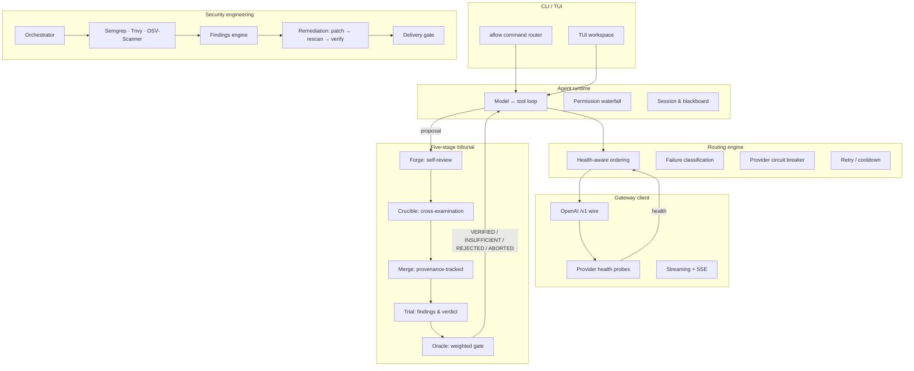

# AgentFlow

**aflow** — terminal-first AI routing and agent platform that tells you which models actually answer.

[](LICENSE)
[](package.json)
[](THIRD_PARTY_NOTICES.md)
[](test/)
[](.github/workflows/test.yml)

---

## What AgentFlow is

AgentFlow is a terminal-first CLI that routes a coding task across many AI models — and tells you which of them actually answer. It measures the gap between *advertised* availability and *working* output, routes around failures, and reviews every proposal through a five-stage adversarial tribunal before you act on it.

**Intended user:** developers and teams who use AI-assisted coding and need reliable model routing, provenance, and safety guarantees without runtime dependencies or hidden supply-chain risk.

**Problem it solves:** Model catalogues advertise availability but not real-time health. Free-tier and aggregator endpoints may return `200` with empty bodies, hiding failures behind apparent success. Most tools collapse "advertised" and "working" into one, leading to silent retries, lost context, and wasted cycles. AgentFlow measures the gap — in `aflow doctor` (probes models), in `aflow route` (walks fallback order and records why each step failed), and in the router itself, which orders candidates by observed health rather than catalogue order.

**Core differentiator:** The five-stage tribunal (Forge → Crucible → Merge → Trial → Oracle) reviews every proposal across models and vectors, fails closed (never a quiet success), and returns a weighted confidence verdict against a gate. Combined with health-aware routing, zero runtime dependencies, and a workspace-scoped permission model that fails closed without a TTY, AgentFlow provides safety and discernment that script-like CLIs and extension-based agents do not.

---

## Architecture



**Execution path:** CLI → runtime → router → gateway → provider. The runtime drives the model↔tool loop; the router walks quality tiers and reorders by observed health; the gateway speaks the OpenAI `/v1` wire either against an external endpoint or the in-repo gateway (`aflow server`). Tribunal stages hang off the runtime, and every write to a session, the Blackboard, or the event log passes through the redaction chokepoint first. Security orchestration runs alongside delivery, scanning findings, remediating, rescanning independently, and gating release.

---

## Features

Implemented in `src/` and covered by the test suite. Capabilities marked *experimental* or *planned* are listed in the [Roadmap](#roadmap-and-limitations).

| Feature | Description |
|---|---|
| **Health-aware model routing** | Candidates ordered by observed health, not catalogue order. Failure classification (empty, rate‑limited, timeout, auth) before a switch is considered. Circuit breaker cools down the tier that just failed. |
| **Self-adversarial tribunal** | Five bounded stages — Forge, Crucible, Merge, Trial, Oracle — review a proposal across models and return a verdict against a confidence gate. Fails closed: a run that cannot finish is `ABORTED`, never a quiet success. |
| **Zero runtime dependencies** | Node standard library only. Dev tooling (ESLint, TypeScript) pinned via lockfile; production code has no external deps. |
| **Workspace‑scoped permissions** | Allowlist → scope approval → allow → ask → deny. Filesystem tools are confined to a resolved workspace root that cannot be widened from inside. Approvals fail closed: no TTY → deny. |
| **Durable, resumable state** | Persistent sessions (atomic writes, corruption‑safe), per‑project Blackboard (goal, tasks, decisions, blockers, bugs, findings, timeline), and an append‑only JSONL event log stored outside the repo. Resume with `aflow chat --resume <id>`. |
| **Git without leaving the loop** | `aflow git` covers status, diff, log, branches, staging, commits (message generated from the staged diff), stash, and conflict resolution. Diffs are parsed from structured git output; paths and branch names are validated first. Does **not** push, fetch, pull, rebase, `reset --hard`, or force‑delete a branch. |
| **Language server in the loop** | When a language server is installed, `aflow lsp` answers diagnostics, hover, and definition queries. A file the agent writes is re‑analysed, and the resulting errors are fed straight into the model's next prompt so it corrects itself in the same task. |
| **MCP servers as agent tools** | Point `mcp.json` (Claude Desktop / OpenCode‑compatible) at any MCP server over stdio or SSE. Its tools appear as namespaced `mcp__server__tool` agent tools — discovered, permission‑gated, and callable like built‑ins. A broken server degrades to isolation, never a failed run. |
| **PageRank repository map** | Walk the workspace once, parse symbols and imports with regex extractors (JS/TS, Python, Go, Rust — no language servers), rank with a pure‑JS PageRank over the import graph (Aider‑style). The agent sees the map inside its context budget, and `aflow map` lets it pull keyword‑re‑ranked structure on demand. |
| **Plugins, without forking AgentFlow** | Plugin is a directory with a manifest and entry file. Five extension points: lifecycle hooks, tools, model providers, slash commands, and budget‑admitted context blocks. Discovery reads manifests only; activation runs in a `node:vm` sandbox whose `require` allows `node:events`. Failure is recorded and skipped; every other plugin keeps working. |
| **Safe tool execution** | Model output, tool results, and fetched files are treated as data, not instructions. Permissions enforced by allowlist. Redaction masks bearer tokens, `sk-…`, `GOCSPX-…`, JWTs, `ghp_…` by field name and by value shape. |
| **Security engineering system** | Scanner orchestration (Semgrep, Trivy, OSV-Scanner), findings deduplication, bounded remediation cycle (patch → test → independent rescan → verify), delivery gate (VERIFIED / BLOCKED_SECURITY / BLOCKED_INCOMPLETE / VERIFIED_WITH_RISKS / NOT_SECURITY_VERIFIED), and SkillSpector security gate for external agent skills. |
| **TODO engine** | Persistent task tracking with type‑specific templates (general, frontend, backend, skill, container). Tasks have verifiable completion conditions tied to the security orchestration lifecycle: manual, auto_test, security_scan, finding_resolved, finding_remediated. |

*Not shipped or guaranteed: SQLite persistence, OAuth provider flows, interactive TUI workspace (the `dashboard` status board exists; an interactive workspace is planned).*

---

## Installation and prerequisites

**Node.js:** `>=20.0.0` (CI runs on Node 20, 22, and 24). ESM‑only.

**No `npm install` required to run from source:**

```sh
# 1. Clone and run immediately (no install step):
git clone https://github.com/anand-cpp/AgentFlow.git
cd AgentFlow

# 2. Verify the CLI:
node bin/aflow.js --version        # aflow 1.0.0
node bin/aflow.js doctor          # environment + reachability check
```

**If you install from npm or use the SEA binary:**

```sh
npm install -g agentflow-cli       # installs `agentflow` and `aflow` on PATH
# or, build a single-executable binary:
npm run build:sea      # produces dist/agentflow (Linux/macOS/Windows)
```

**Configure a provider (required for model‑backed operations):**

The fastest path is the wizard. It tests a key against the provider before writing it, and stores keys in a single owner‑only `keys.env` under your state directory — never in the repo, never in your shell history.

```sh
node bin/aflow.js setup           # pick a provider, paste a key, it is verified, then saved
node bin/aflow.js setup --check   # probe every configured provider and report reachability
```

Twelve upstream providers are available through the in-repo gateway:

| Provider | Model id prefix | Required env var(s) | Notes |
|---|---|---|---|
| Groq | `groq/` | `GROQ_API_KEY` | free tier, no credit card |
| Cerebras | `cerebras/` | `CEREBRAS_API_KEY` | free tier, no credit card |
| Mistral | `mistral/` | `MISTRAL_API_KEY` | free tier, rate‑limited |
| Google Gemini | `gemini/` | `GEMINI_API_KEY` or `GOOGLE_API_KEY` | either key works |
| OpenRouter | `openrouter/` | `OPENROUTER_API_KEY` | free models available |
| Cloudflare Workers AI | `cloudflare/` | `CLOUDFLARE_API_TOKEN` **and** `CLOUDFLARE_ACCOUNT_ID` | multi‑key; account id is part of the URL |
| HuggingFace Inference | `hf/` | `HF_TOKEN` | shared rate limit |
| Together AI | `together/` | `TOGETHER_API_KEY` | $5 signup credit |
| Fireworks AI | `fireworks/` | `FIREWORKS_API_KEY` | $1 signup credit |
| DeepInfra | `deepinfra/` | `DEEPINFRA_API_KEY` | free tier available |
| SambaNova | `sambanova/` | `SAMBANOVA_API_KEY` | free tier available |
| Ollama (local) | `ollama/` | — (no key) | local; never needs a credential |

**Local-only operation:** Point AgentFlow at a local Ollama and no hosted key is configured; requests resolve to `ollama/`. See [docs/PROVIDERS.md](docs/PROVIDERS.md) for strict local‑only behaviour.

---

## Quick start

**Requirements:** Node.js **≥ 20** (CI runs 20, 22, and 24). No `npm install` is required to run the CLI or the test suite.

```sh
git clone https://github.com/anand-cpp/AgentFlow.git
cd AgentFlow

node bin/aflow.js --version      # aflow 1.0.0
node bin/aflow.js doctor         # environment + reachability check
```

### Configure a provider

```sh
node bin/aflow.js setup          # pick a provider, paste a key, it is verified, then saved
node bin/aflow.js setup --check  # probe every configured provider and report reachability
```

Ollama (local, no key needed):

```sh
ollama pull llama3.1
node bin/aflow.js setup --check    # ollama should now report reachable
```

### Run something useful

```sh
node bin/aflow.js chat                                    # interactive session
node bin/aflow.js chat --resume <session-id>              # pick the thread back up
node bin/aflow.js route "explain this stack trace"        # one completion through the fallback cascade
node bin/aflow.js agent run coder "add a --dry-run flag"  # a bounded agent task
node bin/aflow.js tribunal run "Should we use microservices for a team of 3?"
node bin/aflow.js dashboard                               # live status board (read‑only)
node bin/aflow.js security tools --target .               # check scanner availability
node bin/aflow.js todo generate backend                   # generate a backend task list
```

Full command surface: `aflow --help`. Configuration precedence, low → high: `defaults < global file < project file < AGENTFLOW_* env < flags`.

---

## CLI reference

### Global flags (all commands)

| Flag | Description |
|---|---|
| `--json` | Emit machine‑readable JSON on stdout |
| `--quiet` | Suppress non‑essential output |
| `--verbose` | Include diagnostic detail |
| `--no-color` | Disable ANSI colour |
| `--port` | Gateway port (default 20127) |
| `--model` | Default model id |
| `--base-url` | Gateway base URL |

### Top-level commands

| Command | Description |
|---|---|
| `agent run <task>` | Bounded agent task |
| `blackboard` | Durable project workflow state |
| `chat` | Interactive chat with streaming, sessions, and provider failover |
| `config` | Show effective configuration and its origin |
| `connectors` | Browse and connect to AI model providers |
| `dashboard` | Live status board (full‑screen, read‑only) |
| `doctor` | Check environment, gateway, and live provider reachability |
| `fight` | Alias for: `aflow tribunal run` |
| `git` | Inspect and drive the repository |
| `init` | Create a starter project config |
| `logs` | Read the structured event log |
| `lsp` | Query a language server |
| `map` | Show the PageRank‑ranked structural map |
| `mcp` | Inspect and invoke Model Context Protocol servers |
| `models` | List models by provider, optionally probing reachability |
| `plugin` | List, inspect, enable, disable and scaffold plugins |
| `publish` | Check distribution readiness before an npm publish (never publishes) |
| `route` | Run a completion through the fallback cascade |
| `security` | Security orchestration — scans, findings, remediation, delivery gate |
| `server` | Run and control the standalone in‑repo gateway |
| `sessions` | Start, resume, and inspect persistent sessions |
| `setup` | Configure free provider API keys with a guided wizard |
| `status` | Show gateway health and version |
| `skill-scan` | Scan a skill source with SkillSpector before activation |
| `todo` | Persistent task tracking for development tasks |
| `tribunal` | Run the five‑stage self‑adversarial tribunal on a proposal |
| `tui` | Launch the interactive full‑screen terminal workspace |

### Tribunal commands

```
aflow tribunal run "<proposal>" [--domain DOMAIN] [--model ID[,ID]]
aflow tribunal history [--limit N]
aflow tribunal arena "<prompt>" [--quick] [--agents N] [--budget N] [--retries N] [--judge MODEL] [--model MODEL] [--resume ID] [--yes]
aflow fight "<proposal>"                              (alias for: aflow tribunal run)
aflow --tribunal "<proposal>"                         (alias for: aflow tribunal run)
```

### Security commands

```
aflow security scan [profile]     Run a security scan (quick|standard|deep|release)
aflow security findings           List all security findings
aflow security critical           List critical findings
aflow security high               List high findings
aflow security history            Show scan history
aflow security rescan [profile]   Clear findings and re-scan
aflow security verify             Evaluate the delivery gate
aflow security report             Generate a security report
aflow security tools              Check scanner tool availability
```

Global flags: `--target PATH`, `--timeout-ms MS`, `--profile NAME`

### TODO commands

```
aflow todo show [--list ID]      Show a task list
aflow todo add <title>           Add a task to a list
aflow todo complete <id>         Mark a task complete
aflow todo retry <id>            Reset a task to pending
aflow todo generate <type>       Generate a task list (general|frontend|backend|skill|container)
aflow todo list                  List all task lists
```

### Configuration precedence (low → high)

1. **defaults** — hard‑coded in source
2. **global file** — `$XDG_CONFIG_HOME/agentflow/config.json` (or `~/AppData/Roaming/agentflow/config.json` on Windows)
3. **project file** — `.agentflow.json` (walked up from cwd)
4. **AGENTFLOW_* environment variables** — `AGENTFLOW_MODEL`, `AGENTFLOW_BASE_URL`, etc.
5. **flags** — command‑line flags override everything

Run `aflow config` to see the effective value and its origin for each key.

---

## Security engineering system

AgentFlow includes a security orchestration layer that runs alongside delivery. It is implemented in `src/security/` and exposed through `aflow security`.

### Scanner adapters

Three scanner adapters implement the `ScannerAdapter` contract from `src/security/scanners/base.js`:

| Scanner | Purpose | Binary | Install |
|---|---|---|---|
| **Semgrep** | SAST — injection, auth, crypto, path traversal | `semgrep` | `pip install semgrep` |
| **Trivy** | Filesystem, dependencies, secrets, IaC | `trivy` | `winget install aquasecurity.trivy` (Windows), or see trivy.github.io |
| **OSV-Scanner** | Dependency vulnerabilities from lockfiles | `osv-scanner` | Requires Go: `go install github.com/google/osv-scanner/cmd/osv-scanner@latest` |

Scanner binaries are **optional**. AgentFlow detects which are available and reports unavailability honestly — unavailable scanners never appear as `PASS`. They appear as `BLOCKED` or `NOT_RUN`.

### Scan profiles

| Profile | Scanners | Purpose |
|---|---|---|
| QUICK | semgrep, osv-scanner | Fast feedback during development |
| STANDARD | semgrep, osv-scanner, trivy | After feature implementation |
| DEEP | semgrep, osv-scanner, trivy | Before presenting completed work |
| RELEASE | semgrep, osv-scanner, trivy | Before release/deployment |

### Delivery gate

The delivery gate evaluates whether work can be delivered:

| Status | Meaning | Eligible |
|---|---|---|
| VERIFIED | scans passed, no unresolved critical/high findings | yes |
| BLOCKED_SECURITY | unresolved critical/high findings exist | no |
| BLOCKED_INCOMPLETE | required scanners unavailable | no |
| VERIFIED_WITH_RISKS | documented accepted risks | yes |
| NOT_SECURITY_VERIFIED | no sufficient evidence | no |

Never treat `NOT_SECURITY_VERIFIED` or `BLOCKED_*` as secure.

### Remediation workflow

The remediation engine implements a bounded cycle:

```
SCAN → TRIAGE → PATCH → TEST → INDEPENDENT RESCAN → FINDING VERIFICATION → DELIVERY GATE
```

- Patches are applied in isolated worktrees or branches
- A patch does **not** automatically resolve its finding — an independent rescan must confirm the finding is gone before it is marked remediated
- Failed remediation retains its evidence and creates a retryable task
- The loop is bounded (max 3 attempts by default) to prevent infinite repair cycles
- Patches are never automatically merged or pushed

### Skill security gate

External agent skills must pass through NVIDIA SkillSpector before installation or activation. Skill states:

```
DISCOVERED → AWAITING_SECURITY_SCAN → SCANNING → SCAN_FAILED →
SECURITY_FINDINGS → APPROVAL_REQUIRED → APPROVED_FOR_SANDBOX →
SANDBOX_TESTING → VERIFIED → REJECTED → BLOCKED
```

A skill must never become active merely because it downloaded successfully. A failed or incomplete scan must never be represented as successful verification.

---

## Tribunals

The five-stage tribunal reviews proposals through adversarial stages:

| Stage | Role |
|---|---|
| **Forge** | Self‑review by a hostile‑but‑fair reader |
| **Crucible** | Cross‑examination from four attack vectors; each finding must carry a falsifiable proof |
| **Merge** | Surviving proposals synthesized into one hybrid with provenance tracking |
| **Trial** | The hybrid prosecuted for merge‑specific vectors |
| **Oracle** | A weighted confidence gate decides the outcome |

Oracle verdicts:

| Verdict | Confidence | Output |
|---|---|---|
| VERIFIED | ≥ 0.95 | required, non‑empty |
| INSUFFICIENT_CONFIDENCE | < 0.95 | may be present, with caveats |
| REJECTED | 0 | null |
| ABORTED | 0 | null |

The confidence score is a weighted blend of stage scores — it is **not** a calibrated probability. A `VERIFIED` report below 0.95 is rejected by the validator, and a failing executed test overrides any confidence value — the outcome becomes `TESTS_FAILED`, not a number.

---

## TUI and themes

AgentFlow includes an interactive terminal workspace (`aflow tui`) and a read‑only status board (`aflow dashboard`). The TUI is keyboard‑first, terminal‑native (ANSI escapes only), and requires a TTY.

Four themes are included:

| Theme | Description |
|---|---|
| developer | Optimized for coding work |
| futuristic | High‑contrast, modern styling |
| minimal | Reduced visual complexity |
| nature | Calm, muted palette |

Theme switching is handled by the theme engine in `src/tui/theme-engine.js`.

---

## Project structure

```
AgentFlow/
├── bin/                 # CLI entry points (agentflow, aflow)
├── src/
│   ├── cli/             # Command router, registry, output, UI
│   ├── commands/        # 28 registered commands (lazy‑loaded)
│   ├── config/          # 5‑layer configuration resolution
│   ├── core/            # Runtime, routing, gateway, sessions, blackboard, map, LSP, MCP, plugins, tribunal
│   ├── security/        # Orchestrator, scanners, findings, remediation, SkillSpector, TODO
│   └── tui/             # Terminal workspace, themes, panels
├── open-sse/            # Provider‑agnostic SSE engine (inherited from 9Router)
├── config/              # exposure.json
├── docs/                # Detailed documentation (providers, tribunal, security, etc.)
├── test/                # 132 test files, 2116 tests
├── .github/workflows/   # CI: test, security scan, publish, release
└── package.json         # Node >=20, ESM‑only, zero runtime deps
```

---

## Testing and development

| Check | Command | Result (current) |
|---|---|---|
| **Test suite** | `npm test` | 2110 pass, 4 fail, 2 skipped (Node v24.19.0) |
| **Security integration tests** | `node test/security/integration.test.js` | 14 pass, 0 fail |
| **Lint** | `npm run lint` | clean |
| **Typecheck** | `npm run typecheck` | clean |
| **Secret scan (working tree)** | `npm run scan-secrets` | clean |

CI runs the test suite on Node 20, 22, and 24 via `.github/workflows/test.yml`. Contributors can reproduce the full suite locally with `npm test`.

> **Note:** Test totals reflect the most recent local run on the current HEAD. The 4 pre‑existing test failures are unrelated to the security engineering system: one is an intentional insecure test fixture scanned by `scan-secrets`, and others relate to distribution readiness checks.

**Known pre‑existing test failures** (not regressions):
- `test/scan-secrets.test.js` — flags `test/security/fixtures/insecure-code.js`, an intentionally insecure test fixture
- `test/dist/publish.test.js` — distribution readiness check

## CI/CD

| Workflow | Triggers | Purpose |
|---|---|---|
| `test.yml` | push, PR, schedule (hourly) | Test suite on Node 20/22/24 |
| `security-scan.yml` | push, PR, schedule (daily 02:00) | Semgrep SAST + Trivy filesystem scan |
| `publish-npm.yml` | push, PR | Distribution readiness check |
| `release-binary.yml` | push, PR | Release binary build |

## Troubleshooting

| Symptom | Likely cause | Fix |
|---|---|---|
| `gateway unreachable at http://localhost:20127` | No gateway running | Start with `aflow server start`, or point elsewhere with `--base-url` |
| `no provider keys configured` | No credentials | Run `aflow setup` to configure a provider, or use Ollama locally |
| `semgrep: unavailable` | Binary not on PATH | Install with `pip install semgrep` |
| `trivy: unavailable` | Binary not on PATH | Install via winget or from trivy.github.io |
| `osv-scanner: unavailable` | Binary not installed | Install via Go: `go install github.com/google/osv-scanner/cmd/osv-scanner@latest` |
| `command already registered` | Duplicate registration | Ensure command modules self‑register only via `defineCommand` |
| `skill‑scan not found` | Import path wrong | `src/commands/index.js` must import `./skill-scan.js`, not `./commands/skill-scan.js` |

## Roadmap and limitations

Distinguish existing capabilities from proposed improvements:

| Status | Feature |
|---|---|
| **Shipped** | Health‑aware routing, five‑stage tribunal, zero runtime deps, workspace permissions, durable sessions/blackboard, git integration, LSP client, MCP client, PageRank map, plugin system, security orchestration (3 scanner adapters, delivery gate, remediation, SkillSpector), TODO engine, TUI with 4 themes |
| **Planned** | Unified full‑screen interactive TUI workspace (the read‑only `dashboard` status board exists; interactive workspace is planned), agent orchestration (running several agents together), SQLite persistence, OAuth provider flows |

**Meaningful limitations:**

- Model‑backed operations require a configured provider credential or a running local Ollama. Without credentials, the CLI can only perform reachability checks and operations that do not depend on model output.
- The tribunal’s confidence score is a weighted blend of stage scores — it is **not** a calibrated probability. A `VERIFIED` report below 0.95 is rejected by the validator, and a failing executed test overrides any confidence value — the outcome becomes `TESTS_FAILED`, not a number.
- The project inherits the provider/routing engine and gateway from 9Router (MIT). Provenance is carried by documentation rather than git history — the repository begins from an independent initial copy, because copying upstream history would republish credentials that upstream must still rotate.
- `aflow git` does **not** push, fetch, pull, rebase, `reset --hard`, or force‑delete a branch.
- Scanner binaries (semgrep, trivy, osv-scanner, skill-spector) are not bundled and must be installed separately for security scanning to function.

## Contributing

```sh
# 1. Install dev tooling (one‑time):
npm install           # eslint, typescript, @types/node

# 2. Run the test suite:
npm test              # 2110 pass, 4 fail, 2 skipped

# 3. Run security integration tests:
node test/security/integration.test.js  # 14 pass

# 4. Lint and typecheck:
npm run lint          # eslint
npm run typecheck     # tsc --noEmit

# 5. Secret scan:
npm run scan-secrets  # working‑tree scan

# 6. Make a change. Commit with a meaningful message.
```

The project is ESM‑only, Node ≥ 20, and dependency‑free in production. See [`CONTRIBUTING.md`](CONTRIBUTING.md) for the branch and commit conventions, and [`docs/DEBT_LEDGER.md`](docs/DEBT_LEDGER.md) for known, deferred debt.

## Security vulnerability reporting

Report security concerns to the repository security team — do not post them as issues until you have verified the current working tree is exposed. See [`SECURITY.md`](SECURITY.md) and [`SECURITY_DISCLOSURE_STATUS.md`](SECURITY_DISCLOSURE_STATUS.md) for the current disclosure status.

AgentFlow replaced hardcoded upstream credentials during import from 9Router and tracks remaining public exposure with `scripts/check-exposure.mjs`. A fresh clone being clean is not the same as credentials being revoked. Full account, including what was purged and what is still outstanding, in [`SECURITY.md`](SECURITY.md).

---

## License and acknowledgements

**MIT License**. See [LICENSE](LICENSE).

**9Router:** AgentFlow is derived from **9Router** (`decolua/9router`, commit `a99cf572`, tag `v0.5.95`, MIT). The provider/routing engine and gateway were inherited; the routing policy, tribunal, session, and continuity layers are this project's own. Provenance is carried by documentation rather than history — the repository begins from an independent initial commit, because copying upstream history would republish credentials that upstream must still rotate. Full account in [`PROJECT_ORIGIN.md`](PROJECT_ORIGIN.md); inherited notices in [`THIRD_PARTY_NOTICES.md`](THIRD_PARTY_NOTICES.md).

---

Clone AgentFlow and run a diagnostic — the `doctor` command costs nothing and tells you whether your environment and provider keys are ready.

[github.com/anand-cpp/AgentFlow](https://github.com/anand-cpp/AgentFlow)