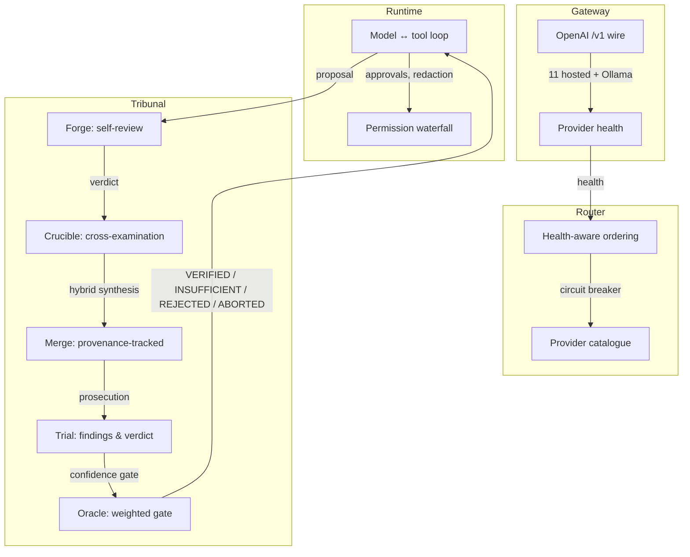

# AgentFlow

**aflow** — terminal-first AI routing and agent platform

[](LICENSE)
[](package.json)
[](THIRD_PARTY_NOTICES.md)
[](https://github.com/anand-cpp/AgentFlow/actions?query=workflow%3Atest+branch%3Amain)
[](https://github.com/anand-cpp/AgentFlow/actions?query=workflow%3Atest+branch%3Amain)

---

## AgentFlow

A terminal-first CLI that routes a coding task across many models — and tells you which of them actually answer. It measures the gap between *advertised* and *working* models, routes around failures, and reviews every proposal through a five-stage adversarial tribunal before you act on it.

**Intended user:** developers and teams who use AI-assisted coding and need reliable model routing, provenance, and safety guarantees without runtime dependencies or hidden supply-chain risk.

**Problem it solves:** Model catalogues advertise availability but not real-time health. Free-tier and aggregator endpoints may return `200` with empty bodies, hiding failures behind apparent success. Most tools collapse "advertised" and "working" into one, leading to silent retries, lost context, and wasted cycles. AgentFlow measures the gap — in `aflow doctor` (probes models), in `aflow route` (walks fallback order and records why each step failed), and in the router itself, which orders candidates by observed health rather than catalogue order.

**Core differentiator:** The five-stage tribunal (Forge → Crucible → Merge → Trial → Oracle) reviews every proposal across models and vectors, fails closed (never a quiet success), and returns a weighted confidence verdict against a gate. Combined with health-aware routing, zero runtime dependencies, and a workspace-scoped permission model that fails closed without a TTY, AgentFlow provides safety and discernment that script-like CLIs and extension-based agents do not.

---

## How it works



**Execution path:** CLI → runtime → router → gateway → provider. The runtime drives the model↔tool loop; the router walks quality tiers and reorders by observed health; the gateway speaks the OpenAI `/v1` wire either in‑repo (`aflow server`) or against an external endpoint. Tribunal stages hang off the runtime, and every write to a session, the Blackboard, or the event log passes through the redaction chokepoint first.

A single request flows: **CLI → runtime → router → gateway → provider**. The diagram above is simplified — the full five-stage tribunal, redaction, and PageRank map all hang off the runtime.

---

## Features

Implemented in `src/` and covered by the test suite. Capabilities marked *experimental* or *planned* are listed in the [Roadmap](#roadmap).

| Feature | Description |
|---|---|
| **Health-aware model routing** | Candidates ordered by observed health, not catalogue order. Failure classification (empty, rate‑limited, timeout, auth) before a switch is considered. Circuit breaker cools down the tier that just failed. |
| **Self-adversarial tribunal** | Five bounded stages — Forge, Crucible, Merge, Trial, Oracle — review a proposal across models and return a verdict against a confidence gate. Fails closed: a run that cannot finish is `ABORTED`, never a quiet success. |
| **Zero runtime dependencies** | Node standard library only. Dev tooling (ESLint, TypeScript) pinned via lockfile; production code has no external deps. |
| **Workspace‑scoped permissions** | Allowlist → scope approval → allow → ask → deny. Filesystem tools are confined to a resolved workspace root that cannot be widened from inside. Approvals fail closed: no TTY → deny. |
| **Durable, resumable state** | Persistent sessions (atomic writes, corruption‑safe), per‑project Blackboard (goal, tasks, decisions, blockers, bugs, findings, timeline), and an append‑only JSONL event log stored outside the repo. Resume with `aflow chat --resume <id>`. |
| **Git without leaving the loop** | `aflow git` and `/git` cover status, diff, log, branches, staging, commits (message generated from the staged diff), stash, and conflict resolution. Diffs are parsed from structured git output; paths and branch names are validated first. Does **not** push, fetch, pull, rebase, `reset --hard`, or force‑delete a branch. |
| **Language server in the loop** | When a language server is installed, `aflow lsp` and `/lsp` answer diagnostics, hover, and definition queries. A file the agent writes is re‑analysed, and the resulting errors are fed straight into the model's next prompt so it corrects itself in the same task. |
| **MCP servers as agent tools** | Point `mcp.json` (Claude Desktop / OpenCode‑compatible) at any MCP server over stdio or SSE. Its tools appear as namespaced `mcp__server__tool` agent tools — discovered, permission‑gated, and callable like built‑ins. A broken server degrades to isolation, never a failed run. |
| **PageRank repository map** | Walk the workspace once, parse symbols and imports with regex extractors (JS/TS, Python, Go, Rust — no language servers), rank with a pure‑JS PageRank over the import graph (Aider‑style). The agent sees the map inside its context budget, and `repo-map`, `aflow map`, and `/map` let it pull keyword‑re‑ranked structure on demand. |
| **Plugins, without forking AgentFlow** | Plugin is a directory with a manifest and entry file. Five extension points: lifecycle hooks, tools, model providers, slash commands, and budget‑admitted context blocks. Discovery reads manifests only; activation runs in a `node:vm` sandbox whose `require` allows `node:events`. Failure is recorded and skipped; every other plugin keeps working. |
| **Safe tool execution** | Model output, tool results, and fetched files are treated as data, not instructions. Permissions enforced by allowlist. Redaction masks bearer tokens, `sk-…`, `GOCSPX-…`, JWTs, `ghp_…` by field name and by value shape. |

*Not shipped or guaranteed: interactive workspace (TUI dashboard exists read‑only; interactive workspace is planned), SQLite persistence, OAuth provider flows.*

---

## Installation and prerequisites

**Node.js:** `>=20.0.0` (CI runs on Node 20, 22, and 24). ESM‑only.

**No `npm install` required to run from source:**

```sh
# 1. Clone and run immediately (no install step):
git clone https://github.com/anand-cpp/AgentFlow.git
cd AgentFlow

# 2. Verify the CLI:
node bin/aflow.js --version        # aflow 1.0.0
node bin/aflow.js doctor          # environment + reachability check
```

**If you install from npm or use the SEA binary:**

```sh
npm install -g agentflow-cli       # installs `agentflow` and `aflow` on PATH
# or, build a single‑executable binary:
npm run build:sea      # produces dist/agentflow (Linux/macOS/Windows)
```

**Configure a provider (required for model‑backed operations):**

The fastest path is the wizard. It tests a key against the provider before writing it, and stores keys in a single owner‑only `keys.env` under your state directory — never in the repo, never in your shell history.

```sh
node bin/aflow.js setup           # pick a provider, paste a key, it is verified, then saved
node bin/aflow.js setup --check   # probe every configured provider and report reachability
```

Eleven hosted providers are free to start and need no credit card:

| Provider | Model prefix | Free tier |
|---|---|---|
| Groq | `groq/` | free tier, no credit card |
| Cerebras | `cerebras/` | free tier, no credit card |
| Mistral | `mistral/` | free tier (rate‑limited) |
| Google Gemini | `gemini/` | free tier, no credit card |
| OpenRouter | `openrouter/` | free models available |
| Cloudflare Workers AI | `cloudflare/` | 10,000 neurons/day |
| Hugging Face Inference | `hf/` | shared rate limit |
| Together AI | `together/` | $5 signup credit |
| Fireworks AI | `fireworks/` | $1 signup credit |
| DeepInfra | `deepinfra/` | free tier available |
| SambaNova | `sambanova/` | free tier available |

**Local-only operation:** Point AgentFlow at a local Ollama and no hosted key is configured; requests resolve to `ollama/`. See the [provider resolution docs](docs/PROVIDERS.md) for strict local‑only behaviour.

---

## Quick start

**Requirements:** Node.js **≥ 20** (CI runs 20, 22, and 24). No `npm install` is required to run the CLI or the test suite.

```sh
git clone https://github.com/anand-cpp/AgentFlow.git
cd AgentFlow

node bin/aflow.js --version      # aflow 1.0.0
node bin/aflow.js doctor         # environment + reachability check
```

### Configure a provider

```sh
node bin/aflow.js setup          # pick a provider, paste a key, it is verified, then saved
node bin/aflow.js setup --check  # probe every configured provider and report reachability
```

Ollama (local, no key needed):

```sh
ollama pull llama3.1
node bin/aflow.js setup --check    # ollama should now report reachable
```

### Run something useful

```sh
node bin/aflow.js chat                                    # interactive session
node bin/aflow.js chat --resume <session-id>              # pick the thread back up
node bin/aflow.js route "explain this stack trace"        # one completion through the fallback cascade
node bin/aflow.js agent run coder "add a --dry-run flag"  # a bounded agent task
node bin/aflow.js tribunal run "Should we use microservices for a team of 3?"
node bin/aflow.js dashboard                               # live status board (read‑only)
```

Full command surface: `aflow --help`. Configuration precedence, low → high: `defaults < global file < project file < AGENTFLOW_* env < flags`.

---

## CLI reference

Global flags (all commands):

| Flag | Description |
|---|---|
| `--json` | Emit machine‑readable JSON on stdout |
| `--quiet` | Suppress non‑essential output |
| `--verbose` | Include diagnostic detail |
| `--no-color` | Disable ANSI colour |
| `--port` | Gateway port (default 20127) |
| `--model` | Default model id |
| `--base-url` | Gateway base URL |

### Top-level commands

| Command | Description |
|---|---|
| `agent run <task>` | Bounded agent task |
| `blackboard` | Durable project workflow state |
| `chat` | Interactive chat with streaming, sessions, and provider failover |
| `config` | Show effective configuration and its origin |
| `dashboard` | Live status board (full‑screen, read‑only) |
| `doctor` | Check environment, gateway, and live provider reachability |
| `fight` | Alias for: `aflow tribunal run` |
| `git` | Inspect and drive the repository |
| `init` | Create a starter project config |
| `logs` | Read the structured event log |
| `lsp` | Query a language server |
| `map` | Show the PageRank‑ranked structural map |
| `mcp` | Inspect and invoke MCP servers |
| `models` | List models by provider, optionally probing reachability |
| `plugin` | List, inspect, enable, disable and scaffold plugins |
| `publish` | Check distribution readiness before an npm publish (never publishes) |
| `route` | Run a completion through the fallback cascade |
| `server` | Run and control the standalone in‑repo gateway |
| `sessions` | Start, resume, and inspect persistent sessions |
| `setup` | Configure free provider API keys with a guided wizard |
| `status` | Show gateway health and version |
| `tribunal` | Run the five‑stage self‑adversarial tribunal on a proposal |

### Tribunal commands

```
aflow tribunal run "<proposal>" [--domain DOMAIN] [--model ID[,ID]]
aflow tribunal history [--limit N]
aflow tribunal arena "<prompt>" [--quick] [--agents N] [--budget N] [--retries N] [--judge MODEL] [--model MODEL] [--resume ID] [--yes]
aflow fight "<proposal>"                              (alias for: aflow tribunal run)
aflow --tribunal "<proposal>"                         (alias for: aflow tribunal run)
```

### Configuration precedence (low → high)

1. **defaults** — hard‑coded in source
2. **global file** — `$XDG_CONFIG_HOME/agentflow/config` (or `~/.config/agentflow/config` on Windows/macOS)
3. **project file** — `.agentflow.json` (or `agentflow.config.json` in the workspace root)
4. **AGENTFLOW_* environment variables** — `AGENTFLOW_MODEL`, `AGENTFLOW_BASE_URL`, etc.
5. **flags** — command‑line flags override everything

Run `aflow config` to see the effective value and its origin for each key.

---

## Architecture and design decisions

AgentFlow's own code lives in `src/`. The module‑boundary map is tracked in [`ARCHITECTURE.md`](ARCHITECTURE.md). Key design decisions:

| Boundary | Reason |
|---|---|
| **Redaction chokepoint** (`src/core/redact.js`) | Masks by field name and by value shape. A credential‑shaped value that survives redaction is refused rather than stored. All output and persistence passes through this point. |
| **Workspace containment** (`src/core/workspace.js`) | Filesystem tools are resolved to a physical path before a run. The root cannot be widened from inside the agent loop. Fail‑closed: if containment cannot be confirmed, the tool is denied. |
| **Fail‑closed approvals** (`src/core/approvals.js`) | No TTY → deny. Model output that requests a shell command or file write without a TTY is automatically refused. |
| **Plugin sandbox** (`src/core/plugins.js`) | Activation runs CommonJS in a `node:vm` sandbox whose `require` allows exactly `node:events`. ESM enters only through the trusted `import()` path. Every registration is namespaced `plugin__<id>__*` so a plugin can never shadow a builtin. |
| **PageRank map** (`src/core/map/`) | Zero‑dependency Aider‑style structural map. Walk the workspace once, parse symbols with regex extractors, build a directed import graph (external packages become stub nodes), run a pure‑JS PageRank pass (damping 0.85, personalization biases). Files carry a token budget (default 2000) and are formatted as a compact list with symbols and reference counts — structure only, never file contents. The map is cached at `.agentflow/repo-map.json` and refreshed incrementally: untouched files keep their cached extraction, only changed files are re‑read. Every failure path degrades to "no map." |
| **Tribunal fails closed** | An unreadable model output becomes a named `INVALID_*` finding or an `ABORTED` run, never a crash and never a silent pass. The confidence model, verdict vocabulary, and invariants are in [`docs/TRIBUNAL.md`](docs/TRIBUNAL.md). |
| **No runtime dependencies** | Production code uses only `node:` builtins. Dev tooling (ESLint, TypeScript) is pinned via the lockfile and excluded from the published `files` array. |

The model‑facing routing/translation engine under `open-sse/` is inherited from 9Router (MIT) and adapted for this project. A module‑by‑module map lives in [`ARCHITECTURE.md`](ARCHITECTURE.md).

---

## Testing and quality

| Check | Command | Result (current) |
|---|---|---|
| **Test suite** | `npm test` | 2100 pass, 0 fail, 2 skipped (Node v24.19.0) |
| **Lint** | `npm run lint` | clean (0 errors) |
| **Typecheck** | `npm run typecheck` | clean (0 errors) |
| **Secret scan (working tree)** | `npm run scan-secrets` | clean (754 tracked files scanned) |

CI runs the test suite on Node 20, 22, and 24 via `.github/workflows/test.yml`. Contributors can reproduce the full suite locally with `npm test`.

> **Note:** Test totals reflect the most recent local run on the current HEAD. The CI matrix status for the default branch is visible in the badge at the top of this file.

---

## Security

Security controls exist; they are not a promise that nothing can go wrong.

- **Redaction at one chokepoint.** `src/core/redact.js` masks by field name *and* by value shape (bearer tokens, `sk-…`, `GOCSPX-…`, JWTs, `ghp_…`). A credential‑shaped value that survives redaction is refused rather than stored.
- **Untrusted by default.** Model output, tool results, and fetched files are treated as data, not instructions. Permissions are enforced by allowlist, not by prompt text, and approvals **fail closed** when there is no TTY.
- **Workspace containment.** Filesystem tools are confined to a workspace root resolved to a physical path before a run, and it cannot be widened from inside.
- **Secret scanning in CI.** `npm run scan-secrets` scans the working tree; `--history` scans every reachable blob. Both run in [CI](.github/workflows/test.yml). Passing a shape‑and‑context scanner is scoped evidence, not proof that no credential exists.
- **Honest about upstream risk.** The upstream credential exposure at `decolua/9router` (advisory **GHSA‑35rj‑mq32‑7gcj**) is that project's to rotate. AgentFlow replaced the hardcoded values during import and tracks the remaining public exposure with `scripts/check-exposure.mjs`, whose CI job is **intentionally red** until rotation is confirmed. A fresh clone being clean is not the same as the credentials being revoked. Full account, including what was purged and what is still outstanding, in [`SECURITY.md`](SECURITY.md).

**Not claimed:** "secure", "zero vulnerabilities", or "safe". Read [`SECURITY.md`](SECURITY.md) before pointing AgentFlow at an untrusted gateway.

Report security concerns to the repository security team — do not post them as issues until you have verified the current working tree is exposed.

---

## Roadmap and limitations

Distinguish existing capabilities from proposed improvements:

| Status | Feature |
|---|---|
| **Shipped** | Health‑aware routing, five‑stage tribunal, zero runtime deps, workspace permissions, durable sessions/blackboard, git integration, LSP client, MCP client, PageRank map, plugin system |
| **Planned** | Unified full‑screen TUI workspace (the read‑only `dashboard` status board exists; an interactive workspace is planned), Agent orchestration (running several agents together), SQLite persistence and OAuth provider flows (upstream components not yet imported) |

**Meaningful limitations:**

- Model‑backed operations require a configured provider credential or a running local Ollama. Without credentials, the CLI can only perform reachability checks and operations that do not depend on model output.
- The tribunal’s confidence score is a weighted blend of stage scores — it is **not** a calibrated probability. A `VERIFIED` report below `0.95` is rejected by the validator, and a failing executed test overrides any confidence value — the outcome becomes `TESTS_FAILED`, not a number.
- The project inherits the provider/routing engine and gateway from 9Router (MIT). Provenance is carried by documentation rather than git history — the repository begins from an independent initial copy, because copying upstream history would republish credentials that upstream must still rotate.
- `aflow git` does **not** push, fetch, pull, rebase, `reset --hard`, or force‑delete a branch.

---

## Contributing

```sh
# 1. Install dev tooling (one‑time):
npm install           # eslint, typescript, @types/node

# 2. Run the test suite:
npm test              # 2100 pass, 0 fail, 2 skipped

# 3. Lint and typecheck:
npm run lint          # eslint
npm run typecheck     # tsc --noEmit

# 4. Secret scan:
npm run scan-secrets  # working‑tree scan

# 5. Make a change. Commit with a meaningful message. Push to the `main` branch.
```

The project is ESM‑only, Node ≥ 20, and dependency‑free in production. See [`CONTRIBUTING.md`](CONTRIBUTING.md) for the branch and commit conventions, and [`docs/DEBT_LEDGER.md`](docs/DEBT_LEDGER.md) for known, deferred debt.

---

## License and acknowledgements

**MIT License**. See [LICENSE](LICENSE).

**9Router:** AgentFlow is derived from **9Router** (`decolua/9router`, commit `a99cf572`, tag `v0.5.95`, MIT). The provider/routing engine and gateway were inherited; the routing policy, tribunal, session, and continuity layers are this project's own. Provenance is carried by documentation rather than history — the repository begins from an independent initial commit, because copying upstream history would republish credentials that upstream must still rotate. Full account in [`PROJECT_ORIGIN.md`](PROJECT_ORIGIN.md); inherited notices in [`THIRD_PARTY_NOTICES.md`](THIRD_PARTY_NOTICES.md).

---

 trying AgentFlow? 

Clone it and run a diagnostic — the `doctor` command costs nothing and tells you whether your environment and provider keys are ready.

[github.com/anand-cpp/AgentFlow](https://github.com/anand-cpp/AgentFlow)

[](https://github.com/anand-cpp/AgentFlow/stargazers)