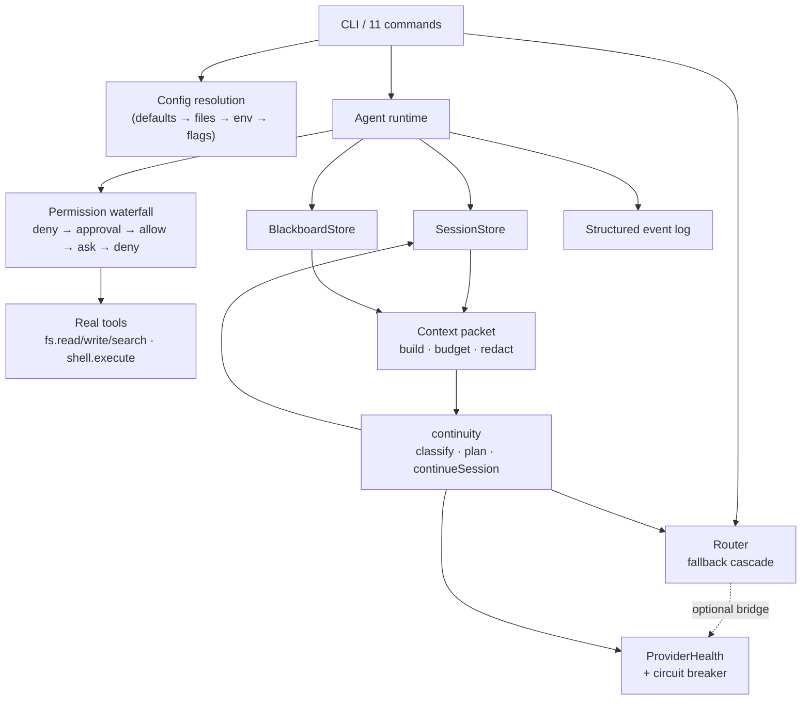

# AgentFlow

**One CLI for every model you can reach.**

Most AI gateways hand you an API key and a list of models and call that done.
AgentFlow is built around the question nobody else answers: *which of these
models actually works right now?*

Free-tier endpoints advertise themselves in catalogues and then return empty
responses, 404s, or expired OAuth. AgentFlow probes them, tells you the truth,
and gives you a fallback cascade that runs on a live signal instead of a promise.

```
$ aflow doctor

GATEWAY
  http://localhost:20127   v0.5.95   reachable   790 models advertised

LIVE PROBES
  oc/muse-spark-1.3-contributor-free   ok        412ms
  ocz/deepseek-v4-flash-free           error     no active credentials
  bzl/auto:free                        error     no active credentials

  790 advertised · 1 of 3 probed returned content

1 warning, 2 errors
```

That distinction — **advertised** versus **working** — is the product.
Against a gateway that is not running, the same command fails cleanly and says
so, rather than pretending:

```
$ aflow doctor
CHECK              STATUS        DETAIL
node               ok            24.19.0
config             ok            defaults
google-oauth       unconfigured  set GOOGLE_OAUTH_CLIENT_ID and GOOGLE_OAUTH_CLIENT_SECRET to enable
gateway            error         http://localhost:20127 — cannot reach gateway at http://localhost:20127
x 1 problem(s) found
```

---

## 1. Status

Early, and honest about it. The CLI, routing engine, dashboard, agent runtime,
real tools, provider health model, and the context/continuity primitives are in
place and tested. A plugin loader is not built yet, and automatic cross-provider
switching is not yet wired into the agent runtime — see §12.

| Area | State |
|---|---|
| Routing engine (`open-sse/`) | Imported from 9Router: engine and provider registry (`open-sse/providers/registry/`) |
| CLI commands | Working — 11 commands, 763 tests passing |
| Live reachability probing | Working |
| TUI dashboard | Working |
| Sessions | Working — durable per-project work units |
| Blackboard | Working — durable per-project workflow state |
| Agent runtime | Working — bounded, registry-driven, eight built-ins |
| Real tools | Working — `filesystem.read`/`write`/`search` + `shell.execute`, wired into the runtime and CLI |
| Tool permissions | Working — scoped allowlists, approval, guards, audit log |
| Provider health | Working — first-class `ProviderHealth` + circuit breaker, bridged into the Router |
| Context packets | Working — model-aware assembly, budgeting, redaction |
| Cross-provider continuity | Working primitives — failure classification, fallback eligibility, tool-replay safety, `continueSession`. Automatic switching in the runtime is **planned**, not shipped |
| Plugin loader | Not started |
| Standalone gateway | Runs via 9Router's server; bundled gateway in progress |

See [`AUDIT/FEATURE_AUDIT.md`](AUDIT/FEATURE_AUDIT.md) for the full
capability comparison and [`AUDIT/ARCHITECTURE_AUDIT.md`](AUDIT/ARCHITECTURE_AUDIT.md)
for what was kept, rewritten, and dropped.

---

## 2. Install

Requires **Node.js 20 or newer** (CI runs the suite on 20, 22 and 24).
**Zero runtime dependencies** — the CLI uses only Node builtins, so there is
nothing to audit or keep patched.

```bash
git clone https://github.com/anand-cpp/AgentFlow.git
cd AgentFlow
node bin/aflow.js doctor
```

To get `aflow` on your PATH:

```bash
npm link
```

---

## 3. Quick start

```bash
aflow init        # write a starter .agentflow.json
aflow doctor      # check the gateway and probe providers
aflow models --probe   # catalogue grouped by provider, and which ones answer
```

`aflow init` writes the config file only. It never writes an API key — pass
that via `AGENTFLOW_API_KEY` or leave it unset to probe anonymously.

---

## 4. Commands

| Command | What it does |
|---|---|
| `aflow doctor` | Gateway health plus live reachability probes |
| `aflow models` | Catalogue grouped by provider; `--probe` to test which work |
| `aflow status` | Cheap health check, safe for a status bar |
| `aflow config` | Resolved config, and which layer each value came from |
| `aflow init` | Write a starter project config |
| `aflow sessions` | Persistent sessions: start, resume, inspect, annotate |
| `aflow blackboard` | Durable per-project workflow state: tasks, decisions, blockers, next action |
| `aflow agent` | The built-in agent fleet: list, inspect a declaration, run one |
| `aflow route` | Run a prompt through the fallback cascade, with a receipt |
| `aflow logs` | Read the structured event log |
| `aflow dashboard` | Interactive terminal dashboard |

Every command takes `--json` for machine-readable output, so AgentFlow scripts
cleanly instead of asking you to parse a table.

---

## 5. Sessions

A session is one unit of work that outlives the process, so the next command —
or the next agent — continues instead of starting from zero.

```bash
aflow sessions new "fix the routing cascade" --model oc/muse
aflow sessions note ses_20261004T071530123Z_a1b2c3 "cascade now falls through" --as coder
aflow sessions resume                    # picks up the current session
aflow sessions inspect ses_20261004T071530123Z_a1b2c3 --entries 0
```

Sessions are stored one JSON file per session under the platform state directory
(`AGENTFLOW_STATE_DIR`, or the XDG/`LOCALAPPDATA` equivalent). Each file is
written to a temporary file and renamed over the target, so a process killed
mid-write leaves the previous version intact rather than a truncated one. A file
that fails to parse is reported as corrupt and left untouched — a damaged session
may be the only surviving record of real work, so the store will not overwrite it
to tidy things up.

Entries cover conversation turns, tool calls and results, routing decisions,
errors, agent attribution, Blackboard references, **context packets, and provider
transitions**. Concurrent appends from several agents take a lock and re-read
inside it, so parallel work does not lose entries.

Everything written passes through the same redaction as the event log, and a
credential-shaped value that survives redaction is refused rather than stored.

---

## 6. Blackboard

Sessions record what happened *in* a run. The Blackboard records what the project
is *for* — the goal, what is open, why a decision was made, what is blocked, what
already failed, and what should happen next. That is the state an agent needs when
it restarts mid-task and finds an empty context window.

```bash
aflow blackboard goal "ship durable state" --objective "finish the milestone"
aflow blackboard task add "implement the store" --detail "corruption safe"
aflow blackboard task t1 --status in_progress
aflow blackboard block "waiting on upstream merge" --task t1 --severity high
aflow blackboard test unit --passed 763 --failed 0 --command "npm test"
aflow blackboard implemented "added store and cli" \
  --files src/core/blackboard.js,src/commands/blackboard.js --commit abc1234
aflow blackboard next "open the PR"
aflow blackboard show                      # goal, open work, blockers, checkpoints
```

`show` is the recovery path: it prints the goal, the next action, work in progress,
open work, blockers, bugs, open questions, active decisions, and the recent
checkpoints, in one screen.

The split with git is deliberate:

```
git         what the code is
blackboard  what we were doing to it
```

Only references are recorded — a path, a sha, a command, a url — never file
contents. A Blackboard that copied source would go stale the moment the file
changed and would then contradict git about the same thing.

State is scoped to the current directory, so running it inside a repo picks up
that repo's record with no flag; `--project` points somewhere else. It lives under
the platform state directory as one `<id>.state.json` per project, written
atomically, alongside an append-only `<id>.events.jsonl` timeline of checkpoints.
The timeline is never replayed into state — it is an independent record, which is
what makes it useful when the state file is damaged.

Every mutating command creates the Blackboard on demand, so there is no
initialisation step to forget. Credentials are redacted before either file is
written, and a value that survives redaction is refused rather than stored.

Pass `--json` for machine-readable output, as with every command.

---

## 7. Agents

An agent is a declaration — a bounded set of permissions, an output contract and a
budget — not a prompt with a name. The runtime reads the fields; nothing anywhere
switches on the agent's id.

```bash
aflow agent                                 # what exists, and how much each may do
aflow agent show coder                      # scopes, allowlist, gates, bounds, contracts
aflow agent run planner "add a health endpoint"
aflow agent run coder "fix the null deref in routing.js" --session ses_2026...
```

Eight agents ship built in:

| Agent | Does | Privilege |
|---|---|---|
| `planner` | Turn an objective into a checkable plan | read-only |
| `coder` | Implement a change and show evidence it works | writes, asks |
| `reviewer` | Judge a change against what it was meant to do | read-only |
| `debugger` | Find the actual cause, then fix that and nothing else | writes, asks |
| `tester` | Prove it works, or prove exactly that it does not | writes, asks |
| `researcher` | Answer from evidence and say how confident that is | reads, network asks |
| `security` | Find the vulnerability that is actually there | read-only |
| `release` | Prepare and verify; publish only when told | asks about everything |

### Scopes are the control. Instructions are not.

This is the part worth internalising, because it is easy to get backwards. Every
agent's prompt contains instructions — *do not push*, *run the tests before claiming
success* — and none of them are security controls. The model is the untrusted party
in this system. "Do not push" in a prompt is a request, and the Coder cannot
`git push origin main` because there is no allowlist entry for it, not because it
was told not to.

So a permission is an entry, and entries resolve in a fixed order:

```
deny  ->  scope approval  ->  allow  ->  ask  ->  deny
```

`deny` is refused outright. Scope-level approval gates the *whole* scope, allowlist
included — "nothing here runs without a human" has to mean nothing. `allow` runs
silently. `ask` needs approval. Everything else is refused.

`allow` and `ask` together are what make a narrow policy practical. The Coder runs
`git status`, `git diff`, `git log` and `npm test` without prompting, because those
change nothing; anything else in the shell scope asks first. An agent that cannot
check repository state without a prompt is an agent nobody runs interactively.

### Real tools, one permission path

The four real tools — `filesystem.read`, `filesystem.write`, `filesystem.search`,
and `shell.execute` — sit behind that same waterfall. None of them checks a policy
of its own; they ask the existing resolver. There is exactly one answer to
"is this allowed", which is the point.

### Approvals fail closed

Interactive on a terminal, one prompt per gated call. Without a TTY there is nobody
to ask, so gated actions are **refused** and the refusal explains how to override it.
`--yes` approves everything and `--deny` refuses everything; both have to be typed on
purpose, because approving unattended is a decision rather than a convenience.

### Bounds are enforced, and checked in both directions

Every agent declares a maximum iteration count, tool-call count, wall clock,
context size and recursion depth. All of them are checked before the work *and*
after each model call — a deadline only enforced between iterations is not a deadline,
because a single slow call overruns it and then reports clean success.

Four outcomes are tracked separately and are never collapsed into "failed":
`completed`, `timedOut`, `cancelled`, and the state the run ended in. A run that both
timed out and failed its output contract is not "timed out" — that reading loses the
second fact.

### The audit trail records what ran

Every tool call is logged before dispatch, so a crash mid-tool still leaves a record.
Only the pre-execute waterfall may rewrite a call; the execute waterfall may not,
because by then the call has already been judged by the permission check, the
approver and the guards, and a rewrite there would dispatch something nobody
approved while the log faithfully described the original command.

A successful run is recorded in both places it belongs: the Session gets the full
outcome — model, state, counts, duration, output, error — and the Blackboard gets an
implementation note with a reference back to the Session. An entry saying only "fixed
the routing cascade" is close to useless a week later.

Pass `--json` for machine-readable output, as with every command.

---

## 8. Context packets and continuity

When a run is interrupted — the provider errored, the context window filled, the
process died — the next attempt has to reconstruct what the previous one knew,
without being told to restart the task from scratch. Two primitives do that.

**A context packet** is a bounded, redacted snapshot assembled from the session,
the Blackboard and the task: identity, the task, open blockers and questions,
recent conversation and tool outcomes, the providers in play, and metadata about
its own completeness. It is budgeted against the model's declared context window
when one is known, an explicit character budget otherwise, and when neither is
known it says so — `limitSource: "unknown"`, `budget: null` — rather than
inventing a number. A packet whose core no longer fits is rejected outright
instead of silently dropping the parts that mattered. Assembly redacts and
deep-freezes the result, so a credential in a note never reaches the wire.

**Continuation** consumes that packet. A provider failure is classified into the
same failure classes the health engine already tracks, fallback is allowed only
when the candidate is eligible (capacity and circuit state), and — the part that
matters for safety — a non-idempotent tool call (`write`, `shell`, `network`,
`package`, `release`) whose outcome was never recorded requires approval before
anything is retried. Replaying a `git push` because the response was lost is not
recovery.

The result is recorded back into the session as a `provider_transition` entry and
the packet itself, so a handoff is replayable: you can see exactly what the
resuming model was allowed to know and why the switch happened.

> **Status.** These primitives are implemented and tested
> (`src/core/context-packet.js`, `src/core/continuity.js`). What is **not** yet
> wired is the automatic path inside `AgentRuntime`: the runtime still builds its
> Router without a `ProviderHealth` instance, so cooldowns are not active during
> an agent run and switching is not triggered end-to-end. That integration is the
> next task — see §12.

---

## 9. Configuration

Precedence, low to high:

```
defaults < global config file < project config file < AGENTFLOW_* env < flags
```

Project configs are discovered by walking up from the working directory.
When more than one exists, **the nearest file wins**.

| Variable | Config key |
|---|---|
| `AGENTFLOW_BASE_URL` | `baseUrl` |
| `AGENTFLOW_API_KEY` | `apiKey` |
| `AGENTFLOW_DEFAULT_MODEL` | `defaultModel` |
| `AGENTFLOW_PROBE_TIMEOUT_MS` | `probeTimeoutMs` |
| `AGENTFLOW_THEME` | `theme` |
| `AGENTFLOW_JSON` | `json` |
| `AGENTFLOW_QUIET` | `quiet` |
| `AGENTFLOW_VERBOSE` | `verbose` |
| `AGENTFLOW_NO_COLOR` | `noColor` |

Booleans accept `1`/`true`/`yes`/`on` and `0`/`false`/`no`/`off`. Unrecognised
values fall back to the default rather than being coerced — `AGENTFLOW_JSON=maybe`
leaves JSON off instead of guessing.

A malformed config file is reported as a diagnostic and skipped; lower
precedence layers still apply, so a typo never makes the CLI unusable.

`aflow config` shows the winner and its source, which turns "why is it
behaving like that" into a one-line answer:

```bash
aflow config --json | jq '.effective.baseUrl, .sources'
```

---

## 10. Architecture



Everything below the CLI is plain Node modules with no runtime dependencies:

- `src/core/routing.js` — the fallback cascade, failure classification, and the
  optional `ProviderHealth` bridge.
- `src/core/provider-health.js` — first-class provider status and a circuit
  breaker keyed on failure class.
- `src/core/agents/` — the runtime, agent declarations, the permission resolver,
  and the real tools.
- `src/core/sessions.js`, `src/core/blackboard.js`, `src/core/events.js` —
  durable state and the structured event log.
- `src/core/context-packet.js`, `src/core/continuity.js` — the context and
  continuation primitives described in §8.
- `open-sse/` — the routing/provider engine imported from 9Router.

Deeper notes: [`AUDIT/ARCHITECTURE_AUDIT.md`](AUDIT/ARCHITECTURE_AUDIT.md),
[`AUDIT/UPSTREAM_CODE_MAP.md`](AUDIT/UPSTREAM_CODE_MAP.md).

---

## 11. Security

AgentFlow prints gateway URLs, provider IDs, and error payloads — which often
contain API keys and OAuth tokens. Every value that reaches a terminal or a log
passes through `src/core/redact.js` first, which masks credentials both by
sensitive field name and by pattern.

```bash
aflow config      # apiKey renders as *** in both text and --json
```

The 9Router engine shipped hardcoded third-party credentials in its source and
history. In AgentFlow's source they are gone — replaced with environment
variables during import:

| Provider | Variables |
|---|---|
| Google | `GOOGLE_OAUTH_CLIENT_ID` / `GOOGLE_OAUTH_CLIENT_SECRET` |
| Antigravity | `ANTIGRAVITY_OAUTH_CLIENT_ID` / `ANTIGRAVITY_OAUTH_CLIENT_SECRET` |
| iFlow | `IFLOW_OAUTH_CLIENT_ID` / `IFLOW_OAUTH_CLIENT_SECRET` |
| Windsurf | `WINDSURF_OAUTH_CLIENT_ID` / `WINDSURF_OAUTH_CLIENT_SECRET` / `WINDSURF_FIREBASE_API_KEY` |

`aflow doctor` reports these as unconfigured rather than pretending they work, and
`scripts/scan-secrets.mjs` runs in CI so no credential gets committed.

> **Disclosure.** A clean working tree is not the whole story. Two of the original
> 9Router credentials — a Windsurf registry API key and an iFlow OAuth client
> secret — were committed and later scrubbed, and the pre-purge objects are still
> retrievable. GitHub tracked this as a public secret-scanning alert. The
> `secrets-exposure` CI job is expected to stay red until the credential owners
> rotate the values; that red build is the correct signal, not a misconfiguration.
> See [`SECURITY.md`](SECURITY.md) and
> [`SECURITY_DISCLOSURE_STATUS.md`](SECURITY_DISCLOSURE_STATUS.md).

---

## 12. Roadmap

Derived from the project's own Blackboard, not aspirational copy. As of this
revision:

| # | Item | State |
|---|---|---|
| T1 | Fix the lost-update race in `withLockFile` | Done |
| T2 | Real tools: `fs.read`/`write`/`search` + `shell.execute` | Done (PR #6) |
| T3 | Correct the README so it does not overstate what ships | Done (this revision) |
| T4 | Wire the real tools into the agent runtime and CLI | Done (PR #8) |
| T5 | Provider health engine (first-class health + circuit breaker) | Done (PR #9) |
| — | Context packet + continuity primitives | Done (this branch) |
| — | Wire automatic cross-provider switching into `AgentRuntime` | Planned |
| — | Plugin loader | Not started |
| — | Bundled standalone gateway | In progress (runs via 9Router's server today) |

---

## 13. Development

```bash
npm test          # 763 tests, no network required
```

Tests cover config precedence and walk-up discovery, argument parsing, command
registration, TUI frame rendering, credential redaction, the lock and session
stores, the Blackboard, provider health, tool permissions and the real tools,
and the context/continuity primitives. They do not hit the network — live
probing is exercised by `aflow doctor` against a running gateway, and the suite
passes with `AGENTFLOW_BASE_URL` pointed at a dead port.

### Exit codes

| Code | Meaning |
|---|---|
| `0` | Healthy |
| `1` | A check failed (gateway down, probes erroring) |
| `2` | Usage error — bad flags, unknown subcommand, missing argument |
| `127` | Unknown command |

Scripts can branch on these instead of scraping output. `2` always means the
command line was wrong and the printed usage is the fix; `1` means the command
was understood but the work did not succeed. `aflow agent run` uses the same
three: `0` completed, `1` failed/timed out/cancelled, `2` usage.

---

## Provenance

AgentFlow is a clean-room rewrite built on MIT-licensed work. Nothing was
copied from projects whose licenses prohibit it, and no model weights, prompts,
or vendor assets are included.

| Source | License | Use |
|---|---|---|
| [decolua/9router](https://github.com/decolua/9router) | MIT | Routing engine and provider registry in `open-sse/`, adapted |
| [opencode](https://github.com/anomalyco/opencode) | MIT | Architecture study only |
| [deepseek-ai/deepseek-harness](https://github.com/deepseek-ai/deepseek-harness) | MIT | Architecture study only |

Qwen code, weights, prompts, and assets are excluded by policy.

Full derivation chain, file-level provenance, and modification log:
[`PROJECT_ORIGIN.md`](PROJECT_ORIGIN.md). Audits in [`AUDIT/`](AUDIT/).

---

## License

MIT. 9Router is MIT, copyright © 2024-2026 decolua and contributors.

Retained third-party obligations: 9Router, Google OAuth client identifiers, and
Google API terms remain subject to their own terms — including the
Google APIs Terms of Service. See [`THIRD_PARTY_NOTICES.md`](THIRD_PARTY_NOTICES.md).
